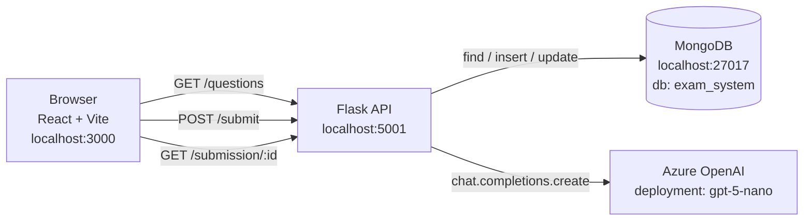
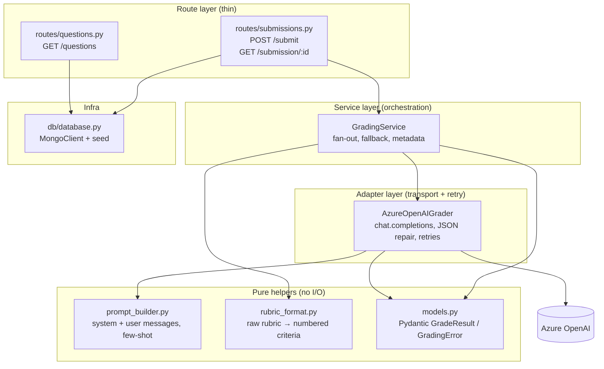
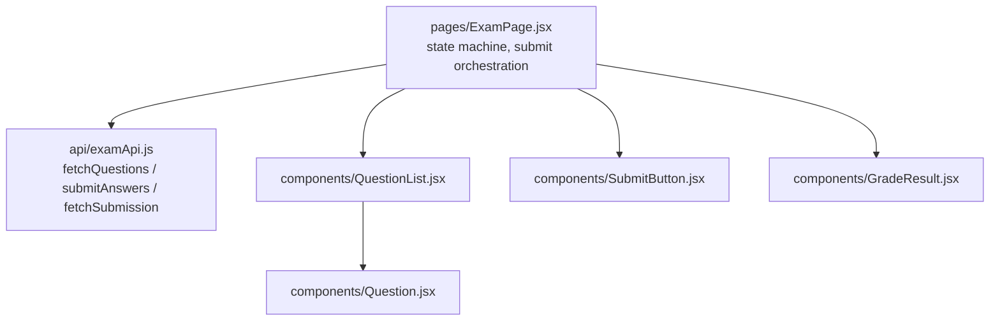

# 01 — System Overview

## Runtime topology



## Layered backend architecture



### Why this layering matters (interview talking points)

| Layer | Responsibility | Knows about |
|---|---|---|
| Route | HTTP shape, status codes, request validation | Flask, JSON, blueprint |
| Service | Business orchestration, fallback policy, metadata | Grader interface, models |
| Adapter | Azure transport, retries, JSON repair | OpenAI SDK, retry/backoff |
| Pure helpers | Deterministic transforms | Strings + Pydantic only |
| Infra | DB connection + seed | pymongo |

**Test isolation**: `GradingService` is unit-testable by injecting a fake `AzureOpenAIGrader`.
**Swap-ability**: replacing Azure OpenAI with another provider only touches the adapter.
**Fail-safe path**: any exception bubbling out of the grader is caught by the service and turned
into a structured fallback `GradeResult`, so persistence never gets garbage.

## Frontend layering



The page owns all state; components are dumb and re-render from props. The API layer is the
**only** place HTTP details live — switching base URL, adding auth, or moving to fetch is a
one-file change.

## File-to-responsibility map

```
python/server/
  app.py                          Flask bootstrap, CORS, blueprint registration
  db/database.py                  MongoClient singleton, seed 5 sample questions
  routes/questions.py             GET /questions
  routes/submissions.py           POST /submit, GET /submission/:id (thin)
  services/
    models.py                     Pydantic: GradeResult (validation rules), GradingError
    prompt_builder.py             System prompt + few-shot + schema-repair message
    rubric_format.py              Normalize raw rubric strings into numbered criteria
    azure_openai_grader.py        AzureOpenAIGrader: client, retries, JSON extraction
    grading_service.py            GradingService: per-question fan-out + fallback
  requirements.txt                Flask, flask-cors, pymongo, python-dotenv, openai, pydantic

python/client/src/
  api/examApi.js                  3 functions, 1 base URL
  pages/ExamPage.jsx              State machine: loading → answering → analyzing → graded
  components/Question.jsx         Single question + textarea
  components/QuestionList.jsx     Maps questions to Question
  components/SubmitButton.jsx     Submit button with submitting state
  components/GradeResult.jsx      Per-question score card; "failed" badge if grading_status='failed'
  styles/*.css                    Plain CSS, no UI library
  vite.config.js                  Dev server :3000, proxy targets :5001
```

## Configuration boundary

All config flows through environment variables loaded from `python/server/.env`:

```
MONGODB_URI, DB_NAME, PORT
AZURE_OPENAI_ENDPOINT, AZURE_OPENAI_API_KEY (or AZURE_OPENAI_AD_TOKEN),
AZURE_OPENAI_DEPLOYMENT, AZURE_OPENAI_API_VERSION
GRADING_MAX_WORKERS (optional), GRADING_MAX_COMPLETION_TOKENS (optional),
GRADING_REASONING_EFFORT (optional), GRADING_VERBOSITY (optional),
GRADING_SEED (optional, deterministic grading aid)
```

No secrets in code, no secrets in repo, no secrets in the frontend bundle.
