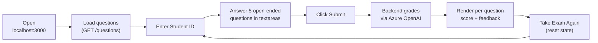
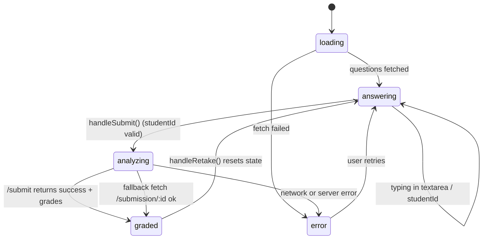
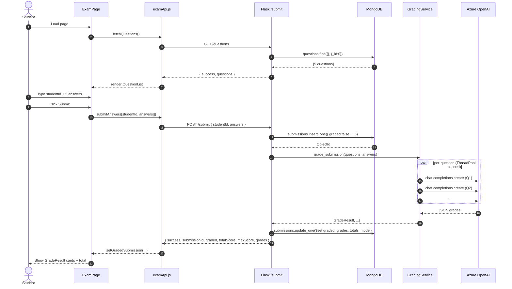
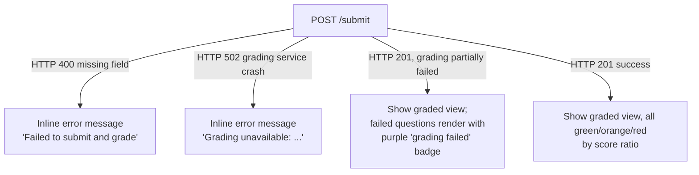
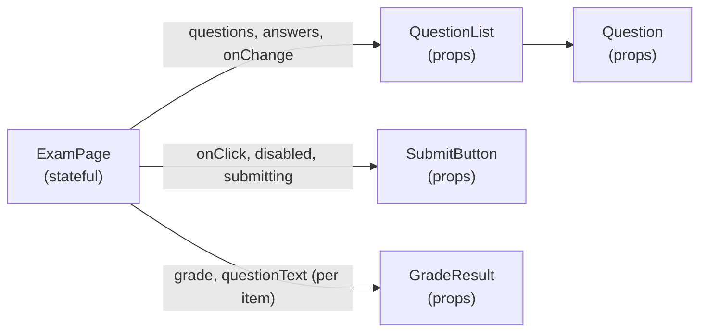

# 02 — User Flow (Questions & Answers)

The student-facing flow from "page load" to "see graded results", with both the UI state machine
and the network sequence.

## High-level journey

## Frontend state machine — `ExamPage.jsx`

State variables in the page:

| Variable | Meaning |
|---|---|
| `questions` | Array from GET /questions |
| `answers` | `{ [questionId]: text }` map keyed by question id |
| `studentId` | Required before submit is enabled |
| `loading` | Initial questions fetch |
| `submitting` | POST /submit in flight |
| `grading` | After submit returned, before grades are bound to state |
| `gradedSubmission` | `{ studentId, totalScore, maxScore, grades[] }` once available |
| `error` | Last user-facing error string |

`analyzing = submitting || grading` drives a full-screen "Analyzing Exam" overlay so the user
gets one consistent loading affordance for the whole submit-and-grade round-trip.

## Network sequence — happy path

The frontend prefers the inline `grades` returned by `/submit` (single round-trip).
If `/submit` doesn't carry them (legacy / partial response), it falls back to
`fetchSubmission(submissionId)` so the contract stays compatible.

## Failure paths the user can see

Key UX rule: the user **always** lands on a deterministic next state. There is no infinite spinner
and no silent failure; every Azure error becomes either an HTTP 502 (total) or a per-question
fallback grade (partial) that the UI clearly labels.

## Component data flow

All children are presentational. Adding a new field to grade output (e.g. confidence) only changes
`GradeResult.jsx` and `models.py` — no plumbing through intermediate components.
