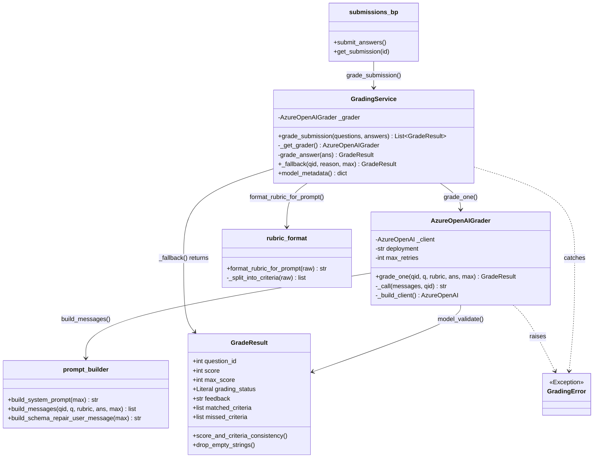
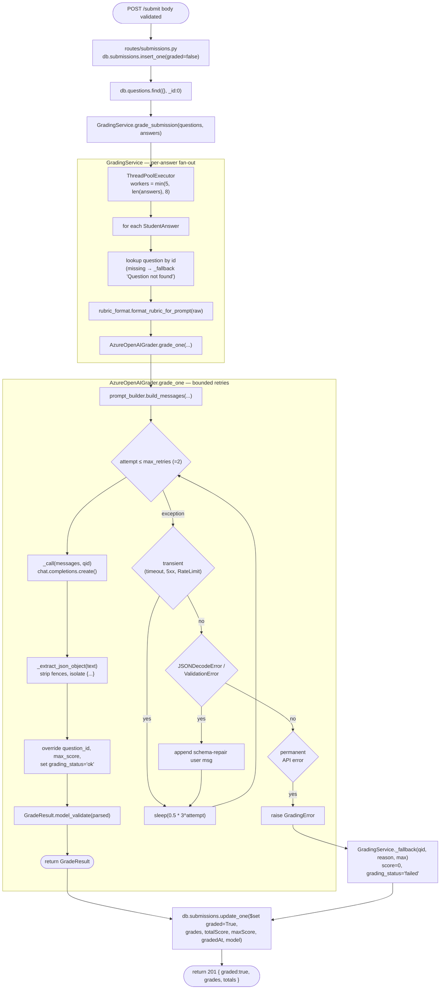
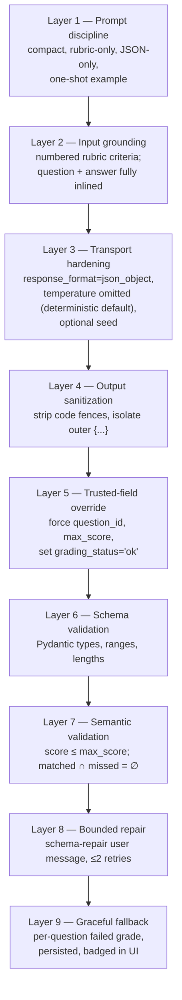
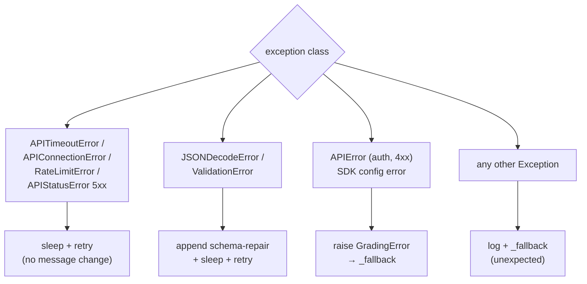

# 03 — LLM Orchestration

End-to-end view of how a single `POST /submit` becomes a set of validated, persisted grades —
class by class, function by function. This is the critical-path diagram for an interview.

## Class collaboration



## End-to-end orchestration flow



## Function-by-function (high level)

### `routes/submissions.py :: submit_answers()`
1. Validate JSON body has `studentId` and `answers` (list).
2. Insert raw submission with `graded:false`.
3. Load all questions (no `_id`).
4. Call `GradingService.grade_submission(questions, answers)` inside a `try/except` — any
   uncaught exception returns **HTTP 502** with `{ graded:false, status:"grading_error" }`
   and the submissionId so the client can retry later.
5. Sum totals, write a single `update_one` with `grades`, `totalScore`, `maxScore`, `gradedAt`,
   `model` metadata.
6. Return inline grades so the frontend can render without a second round-trip.

### `services/grading_service.py :: GradingService`
- **`grade_submission(questions, answers)`** — entry point.
  - Build `by_id` lookup for O(1) question access.
  - Lazily construct `AzureOpenAIGrader`. If construction itself fails (e.g. missing env),
    return one fallback per answer — never crash the route.
  - Define inner `grade_answer(ans)` closure. It looks up the question, formats the rubric,
    and delegates to `grader.grade_one(...)`. **Catches `GradingError` and any other exception**
    and converts to a `_fallback` — *one bad call can never poison the batch*.
  - Pick worker count: `min(5, len(answers), 8)`, env-overridable via `GRADING_MAX_WORKERS`.
  - Fan out via `ThreadPoolExecutor`. Order is preserved by `executor.map`.
- **`_fallback(question_id, reason, max_score)`** — returns a *valid* `GradeResult` with
  `score=0`, `grading_status="failed"`, and a truncated reason in `feedback`. This is still a
  schema-valid object, so persistence is safe.
- **`model_metadata()`** — static descriptor of the provider, deployment, and api version
  written into the submission document for auditability.

### `services/azure_openai_grader.py :: AzureOpenAIGrader`
- **`__init__`** — accepts an optional `client` and `deployment` for tests; defaults to env.
- **`_build_client()`** — normalizes `AZURE_OPENAI_ENDPOINT` (strips paths, ensures trailing `/`),
  resolves API key *or* AD token, picks API version with sensible fallback. Raises a
  human-readable `OpenAIError` when env is missing — not a stack trace.
- **`grade_one(...)`** — the retry loop:
  - Build messages once via `prompt_builder.build_messages(...)`.
  - Up to `max_retries + 1` attempts (default 3).
  - Catch `(APITimeoutError | APIConnectionError | RateLimitError)` → transient, sleep, retry.
  - Catch `APIError` with status in `{500,502,503,504}` → transient, sleep, retry.
  - Catch other `APIError` → **permanent**, raise `GradingError` immediately (no point retrying
    a 401).
  - Catch `(JSONDecodeError | ValidationError)` → append a `build_schema_repair_user_message(...)`
    to the conversation and retry. This nudges the model back onto the schema rather than just
    re-asking blindly.
  - Backoff: `0.5 * 3**attempt` seconds (0.5s, 1.5s).
- **`_call(messages, qid)`** — issues `chat.completions.create` with `response_format=json_object`.
  Defensively pops unsupported kwargs (`response_format`, `max_completion_tokens`,
  `reasoning_effort`, `verbosity`, `seed`) and retries when the deployment rejects them, so the
  same code works across older and newer Azure deployments.
- **`_extract_json_object(text)`** — strips ```` ```json ```` fences and isolates the outermost
  `{...}` so we never feed leading prose into `json.loads`.
- After parsing, the adapter **forces** `question_id` and `max_score` from the trusted route
  inputs and sets `grading_status="ok"` — the model cannot lie about which question it just graded.

### `services/prompt_builder.py` (pure, no I/O)
- **`build_system_prompt(max_score)`** — strict grader instructions:
  - Use only the question + numbered rubric + answer.
  - No outside knowledge.
  - `matched_criteria` and `missed_criteria` must be disjoint.
  - Score is an integer `[0, max_score]`; `max_score` in JSON must equal the parameter.
  - Output **valid JSON only** — no markdown, no fences, no prose.
  - Includes a tiny one-shot example to lock down the JSON shape.
- **`build_messages(...)`** — assembles the `[system, user]` array.
- **`build_schema_repair_user_message(max_score)`** — appended after a malformed-output retry
  to remind the model of the required keys and constraints.

### `services/rubric_format.py` (pure, no I/O)
- **`format_rubric_for_prompt(raw)`** — converts the seeded `"Should mention: a, b, c"` string
  into a numbered, mandatory-criteria block. Capped at 12 items so the prompt never explodes.

### `services/models.py :: GradeResult`
- Pydantic v2 model. Fields: `question_id`, `score`, `max_score (1..100)`, `grading_status`
  (`ok`|`failed`), `feedback (1..500 chars)`, `matched_criteria` (list, items ≤ 160 chars),
  `missed_criteria` (list, items ≤ 160 chars).
- **`drop_empty_strings`** — preprocesses arrays to remove `None` / blanks before validation.
- **`score_and_criteria_consistency`** — model validator that fails if `score > max_score` or if
  the model put the same criterion in both arrays. **This is the last line of defense before
  persistence.**

## Hallucination-prevention strategy (interview answer)

| Risk | Mitigation | Where |
|---|---|---|
| Model uses outside knowledge | System prompt forbids it; rubric is pre-formatted as numbered criteria | `prompt_builder.py`, `rubric_format.py` |
| Model rewards vague answers | System prompt: "Do not assume facts not stated in the student answer" | `prompt_builder.py` |
| Model returns wrong `question_id` | Adapter overrides with trusted value before validation | `azure_openai_grader.py :: grade_one` |
| Model invents a `max_score` | Adapter overrides; Pydantic also rejects mismatches | `azure_openai_grader.py`, `models.py` |
| Model returns garbage JSON | `_extract_json_object` + schema-repair retry, then fallback | `azure_openai_grader.py` |
| Model lists a criterion as both matched AND missed | `score_and_criteria_consistency` fails validation → retry → fallback | `models.py` |
| Score exceeds max | Same model validator | `models.py` |
| Azure outage | Bounded retries on transient codes; permanent errors fail fast | `azure_openai_grader.py` |
| One bad question crashes the batch | `GradingService.grade_answer` catches everything, returns `_fallback` | `grading_service.py` |
| Total grading failure | Route returns 502 with submissionId; submission stays `graded:false` for retry | `routes/submissions.py` |

## Hallucination prevention — deep dive

The table above is the summary. This section shows **exactly where and how** each defense lives,
so the interviewer can see we treat the LLM as an *untrusted, structured-output service*, not as
a source of truth.

### Defense layers (defense-in-depth)



### Layer 1 — Prompt discipline (`prompt_builder.py`)

The system prompt is short, declarative, and forbids inference outside the rubric. Excerpts:

```
You are an exam grader. Use ONLY: the exam question, the numbered rubric criteria,
and the student's answer.
Rules:
- No outside knowledge unless the rubric explicitly includes it.
- Do not assume facts not stated in the student answer. If evidence is missing or vague,
  lower the score and say what is missing in feedback.
- matched_criteria: short strings naming rubric points the answer clearly satisfies
  (verbatim or paraphrase tied to the answer).
- missed_criteria: short strings for rubric points not addressed or too weak to count.
- matched_criteria and missed_criteria must be disjoint (no item in both).
- Score is an integer from 0 through {max_score} inclusive.
- max_score in JSON must equal {max_score}.
- feedback: max 500 characters, concise, evidence-based, rubric-linked.
- Output VALID JSON only — no prose, no markdown, no code fences.
```

A one-shot `_FEW_SHOT` example anchors the JSON shape so the model does not invent fields:

```
Example (shape only; different topic):
Question: What is 2+2?
Rubric lines: 1. State the sum  2. Show brief reasoning
Student Answer: The sum is four because 2+2 equals 4.
Valid JSON:
{"question_id":99,"score":2,"max_score":2,"feedback":"States the sum and gives reasoning.",
 "matched_criteria":["State the sum","Show brief reasoning"],"missed_criteria":[]}
```

Why: `gpt-5-nano` is small. Compact, declarative rules with one shape example outperform long
prose instructions and reduce drift.

### Layer 2 — Input grounding (`rubric_format.py`)

Raw rubrics from the DB look like `"Should mention: inheritance, overriding, code example"`.
That phrasing tempts the model to "fill in" what it knows about the topic. We rewrite it into a
**numbered, mandatory checklist**:

```
Criteria (grade only against these; every bullet is mandatory to address for full credit):
1. inheritance
2. overriding
3. code example
```

The list is capped at 12 items so the prompt cannot blow up, and `matched_criteria` /
`missed_criteria` get a stable vocabulary to reference back.

### Layer 3 — Transport hardening (`AzureOpenAIGrader._call`)

```python
kwargs = dict(
    model=self.deployment,
    messages=messages,
    response_format={"type": "json_object"},  # JSON mode — model SDK rejects non-JSON
)
# Omit temperature: gpt-5-nano only allows service default (deterministic-ish).
# Optional GRADING_SEED for reproducible grading in dev/test.
```

- `response_format=json_object` makes the API itself reject non-JSON before we ever see it.
- Temperature is deliberately omitted (the model's service default for nano is already low).
- An optional `seed` (env-driven, mixable with `question_id`) gives reproducible outputs across
  runs — invaluable when reviewing whether a "weird" grade is the prompt or the model.

### Layer 4 — Output sanitization (`_extract_json_object`)

Even with JSON mode, defensive parsing strips ```` ```json ```` fences and isolates the outermost
`{...}`:

```python
def _extract_json_object(text: str) -> str:
    s = text.strip()
    if "```" in s:           # strip ```json ... ``` fences if present
        ...
    first = s.find("{")
    last = s.rfind("}")
    if first == -1 or last == -1 or last <= first:
        raise json.JSONDecodeError("No JSON object found in model output", s, 0)
    return s[first : last + 1]
```

This neutralizes the most common LLM JSON failures (leading prose, trailing apology, accidental
markdown) without trusting the model to obey our prompt.

### Layer 5 — Trusted-field override (`grade_one`)

Before validation we **overwrite** identity fields with the values the route already trusts:

```python
parsed["question_id"] = question_id      # not what the model said
parsed["max_score"]   = max_score        # not what the model said
parsed["grading_status"] = "ok"          # we, not the model, decide success
```

The model literally cannot misattribute a grade to the wrong question, and cannot inflate the
grading scale.

### Layer 6 — Schema validation (`models.py :: GradeResult`)

Pydantic v2 enforces types and bounds *before* the result is returned to the orchestrator:

```python
class GradeResult(BaseModel):
    question_id: int
    score: int = Field(ge=0)
    max_score: int = Field(ge=1, le=100)
    grading_status: Literal["ok", "failed"] = "ok"
    feedback: str = Field(min_length=1, max_length=500)
    matched_criteria: List[CriterionStr] = Field(default_factory=list, max_length=20)
    missed_criteria:  List[CriterionStr] = Field(default_factory=list, max_length=20)
```

- `feedback` is bounded → no 10kB hallucinated essays in the DB.
- Each criterion is `max_length=160` and stripped → no paragraph-as-criterion.
- Lists capped at 20 items → no runaway "matched 47 things" output.

### Layer 7 — Semantic validation (`score_and_criteria_consistency`)

Pure type checks aren't enough. A model validator catches *logical* inconsistencies:

```python
@model_validator(mode="after")
def score_and_criteria_consistency(self):
    if self.score > self.max_score:
        raise ValueError(f"score ({self.score}) must not exceed max_score ({self.max_score})")
    matched_n = {norm(x) for x in self.matched_criteria}
    missed_n  = {norm(x) for x in self.missed_criteria}
    if matched_n & missed_n:
        raise ValueError("matched_criteria and missed_criteria must not list the same criterion")
    return self
```

Two real failures it catches:
- Model returns `score=12, max_score=10` (over-credit hallucination).
- Model lists `"inheritance"` in both matched and missed (incoherent reasoning).

Both raise `ValidationError`, which is treated as a retry-with-repair candidate at Layer 8.

### Layer 8 — Bounded schema-repair retry (`grade_one`)

When parsing or validation fails, we don't just retry — we **append a targeted repair message**
and try again, capped at `max_retries=2`:

```python
except (json.JSONDecodeError, ValidationError) as e:
    last_reason = f"invalid-output: {type(e).__name__}: {e}"
    messages = messages + [
        {"role": "user", "content": build_schema_repair_user_message(max_score)}
    ]
```

`build_schema_repair_user_message` re-states the required keys, ranges, and disjointness
constraint. After 2 repair attempts the loop gives up and raises `GradingError` — we never enter
an unbounded "ask again" loop with a misbehaving model.

Backoff is exponential (`0.5 * 3**attempt` → 0.5s, 1.5s) and applies to both transient and
invalid-output retries.

### Layer 9 — Graceful fallback (`GradingService._fallback`)

If all repair attempts fail (or the adapter raises a permanent API error), the service returns a
**schema-valid** fallback grade rather than crashing or persisting garbage:

```python
GradeResult(
    question_id=qid,
    score=0,
    max_score=max_score,
    grading_status="failed",
    feedback=f"Grading unavailable: {reason}",   # truncated to 500 chars
    matched_criteria=[],
    missed_criteria=[],
)
```

Two important properties:
- The submission document is **never partially written** — every grade in `grades[]` is a valid
  `GradeResult`, with `grading_status` distinguishing real grades from fallbacks.
- The frontend renders failed grades with a purple `grading failed` badge (`GradeResult.jsx`),
  so a human reviewer can re-grade those answers manually without ambiguity.

### Failure-class decision matrix



### What we deliberately do **not** do (and why)

| Tempting "improvement" | Why we skip it |
|---|---|
| Auto-grade twice and average | Doubles cost, hides hallucinations instead of catching them. Validation catches the bad one. |
| Let the model set `max_score` per question | The route owns the grading scale; the model must not influence it. |
| Free-form `feedback` with no length cap | A 5kB hallucinated essay is still a hallucination, just longer. 500 chars forces concrete, rubric-linked feedback. |
| Loose JSON parsing (`ast.literal_eval`, regex extraction of fields) | Introduces silent acceptance of malformed output. We prefer "fail → repair → fallback". |
| Persist `null` fields when grading fails | A nullable `grades[i]` would force every consumer to handle two shapes. A fallback `GradeResult` keeps the contract uniform. |
| Unbounded retries until success | Cost and latency unbounded; one bad answer would block the whole batch. We cap and degrade. |

## Performance characteristics

- **Concurrency**: per-question grading is parallelized with a `ThreadPoolExecutor` capped at 5
  workers (env-tunable up to 8). For 5 questions, end-to-end latency ≈ slowest single call.
- **Token budget**: prompts are intentionally compact for `gpt-5-nano`. Optional
  `GRADING_MAX_COMPLETION_TOKENS` is *off by default* because reasoning-style models can consume
  the budget on internal reasoning before emitting JSON, leaving an empty assistant message.
- **Determinism**: optional `GRADING_SEED` (and `GRADING_SEED_INCLUDE_QUESTION_ID`) feeds a
  per-question `seed` to the API for reproducible grading in dev/test.

## What I would add next (interview "what's missing")

- Idempotency key on `/submit` to make retries safe across network errors.
- Background grading queue (Celery/RQ) for very large batches; current sync flow is fine for 5–10 Qs.
- Structured tracing (OpenTelemetry) around `grade_one` calls for production observability.
- Unit tests with a fake `AzureOpenAIGrader` exercising the four retry classes.
