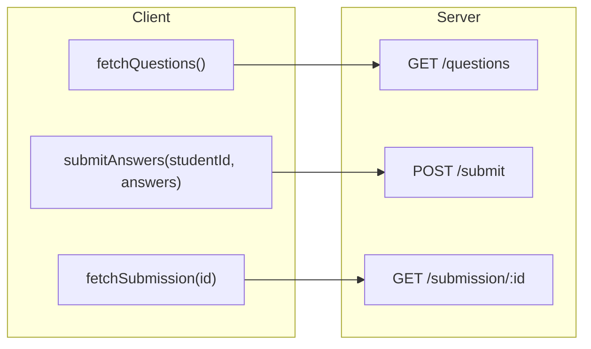
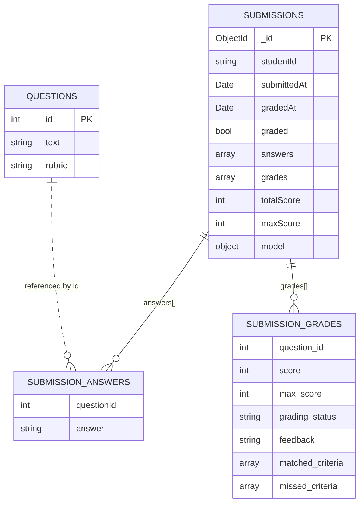
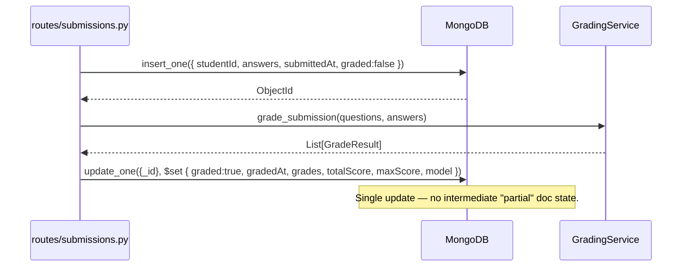

# 04 — Data Model & Contracts

The shapes that travel between layers. Same JSON contract, frontend to MongoDB.

## API contracts



### `GET /questions`

```json
{
  "success": true,
  "questions": [
    { "id": 1, "text": "Explain polymorphism...", "rubric": "Should mention: ..." }
  ]
}
```

### `POST /submit`

Request:
```json
{
  "studentId": "abc123",
  "answers": [
    { "questionId": 1, "answer": "Polymorphism lets..." }
  ]
}
```

Response 201 (graded synchronously, inline):
```json
{
  "success": true,
  "status": "graded",
  "submissionId": "65f0a1...",
  "graded": true,
  "totalScore": 34,
  "maxScore": 50,
  "grades": [ /* GradeResult[] */ ]
}
```

Response 502 (grading service totally failed, submission stored ungraded):
```json
{
  "success": false,
  "status": "grading_error",
  "submissionId": "65f0a1...",
  "graded": false,
  "totalScore": null,
  "maxScore": null,
  "grades": null,
  "error": "Grading unavailable: <Type>"
}
```

### `GET /submission/<submission_id>`

```json
{
  "success": true,
  "submission": {
    "_id": "65f0a1...",
    "studentId": "abc123",
    "submittedAt": "2026-04-15T12:00:00",
    "gradedAt":   "2026-04-15T12:00:04",
    "graded": true,
    "answers":  [ { "questionId": 1, "answer": "..." } ],
    "grades":   [ /* GradeResult[] */ ],
    "totalScore": 34,
    "maxScore": 50,
    "model": {
      "provider": "azure-openai",
      "deployment": "gpt-5-nano",
      "api_version": "2024-12-01-preview"
    }
  }
}
```

`400` invalid id, `404` not found, `500` unexpected.

## `GradeResult` JSON (the unit of grading)

```json
{
  "question_id": 1,
  "score": 7,
  "max_score": 10,
  "grading_status": "ok",
  "feedback": "Covered inheritance and overriding; missed concrete code example.",
  "matched_criteria": ["inheritance", "method overriding"],
  "missed_criteria": ["code example"]
}
```

Validated by `services/models.py :: GradeResult` (Pydantic v2). Constraints:

| Field | Rule |
|---|---|
| `score` | int, `0 ≤ score ≤ max_score` |
| `max_score` | int, `1..100` |
| `grading_status` | `"ok"` \| `"failed"` |
| `feedback` | non-empty, ≤ 500 chars |
| `matched_criteria` | ≤ 20 items, each ≤ 160 chars, trimmed, non-empty |
| `missed_criteria` | same constraints |
| disjointness | `matched_criteria` and `missed_criteria` must not share an item |

Fallback grade (per-question failure) keeps the same shape:
```json
{
  "question_id": 3,
  "score": 0,
  "max_score": 10,
  "grading_status": "failed",
  "feedback": "Grading unavailable: transient: APITimeoutError",
  "matched_criteria": [],
  "missed_criteria": []
}
```

## MongoDB collections — `db: exam_system`



`questions` is seeded by `db/database.py :: init_db()` on first run with 5 CS questions
(polymorphism, SQL vs NoSQL, HTTP, Git, Big-O).

## Lifecycle of a submission document



If `GradingService` raises (rare, only env/init crashes), the document remains `graded:false`
and is reachable via `GET /submission/:id` for retry tooling — no orphan state and no corrupted
grades persisted.

## Why snake_case in `grades[]` but camelCase elsewhere

`grades[]` items mirror the **Pydantic schema**, which mirrors the **LLM JSON schema**. Keeping
those three the same shape removes a translation layer and keeps the contract one-to-one. The
surrounding submission fields (`studentId`, `submittedAt`, `gradedAt`, `totalScore`, `maxScore`)
follow the existing JS-style camelCase the route already used. The frontend reads both naturally.
